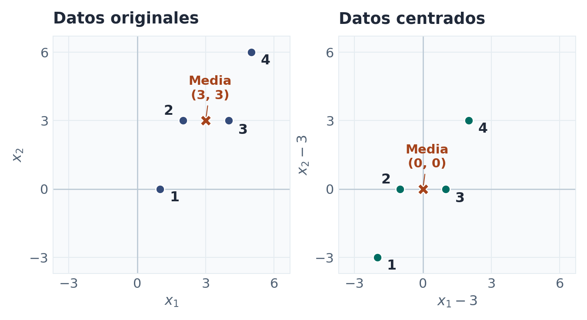
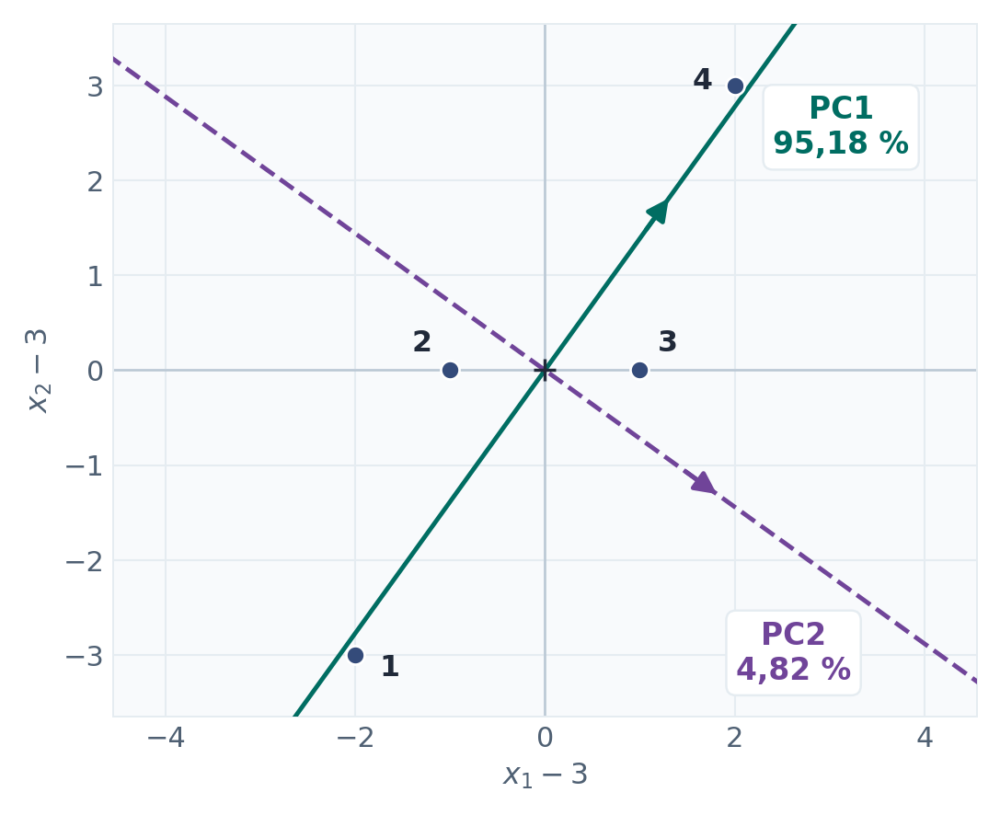
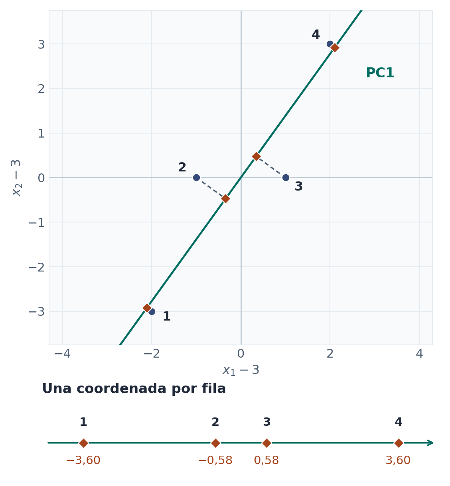

# Preparación de datos y PCA

[Inicio](README.md) · [Ayuda memoria](06-ayuda-memoria.md#preparación-y-pca) · [Practicar](07-ejercicios-propuestos.md#preparación-y-pca) · [Pauta](09-pauta.md#preparación-y-pca) · [Siguiente →](02-modelos-lineales.md)

## Teoría

Después de entender el problema y revisar los datos, la etapa de preparación de CRISP-DM convierte esos datos en algo que el modelo pueda usar. Con muchas características, el modelo puede aprender ruido o repetir información. Si ajusta muy bien los datos de entrenamiento y falla con datos nuevos, puede haber **sobreajuste**.

Imagina una tabla con largo, ancho y área de una hoja. **Seleccionar** largo y ancho deja esas columnas tal como estaban. **Extraer** características crea nuevas coordenadas, por ejemplo combinando largo y ancho en una componente.

| Método de selección | Cómo decide |
| --- | --- |
| Umbral de varianza | Conserva columnas cuya varianza supera el umbral. Una columna constante tiene varianza cero. Revisa las escalas antes de comparar. |
| Filtro | Puntúa cada columna por separado. Pearson mide asociación lineal. El chi-cuadrado de independencia compara frecuencias observadas y esperadas. |
| Envolvente | Usa un modelo para evaluar subconjuntos. RFE ajusta, elimina las variables menos importantes y vuelve a ajustar. La selección secuencial parte sin variables y agrega una por paso (**hacia adelante** o *forward*), o parte con todas y quita una por paso (**hacia atrás** o *backward*), según el rendimiento de validación. |
| Integrado | La elección se apoya en el entrenamiento. L1 puede dejar pesos en cero. Un árbol puede ordenar atributos por reducción de impureza. |

Pearson toma valores entre $-1$ y $1$. Para ordenar por **fuerza lineal**, usa la magnitud. Un valor cercano a cero puede aparecer incluso cuando existe una relación curva. Con una columna constante su denominador es cero. Para chi-cuadrado, usa conteos en una tabla de contingencia. En scikit-learn, `SelectKBest(chi2, k=...)` requiere entradas no negativas, como indicadores o conteos. Una categoría sin orden se puede representar con indicadores. Asignarle números arbitrarios impone un orden.

La selección integrada con árboles también se puede contrastar con **importancia por permutación**. En datos de evaluación, desordena una columna y mide cuánto empeora el rendimiento del modelo ya ajustado. Si dos columnas son redundantes, alterar una sola puede tener poco efecto.

### Qué hace PCA

Piensa en una nube de puntos vista desde distintos ángulos. **PCA** busca el eje unitario sobre el que la nube proyectada más se esparce. Ese eje es PC1. PC2 es perpendicular a PC1 y captura la mayor varianza restante. Cada coordenada nueva combina columnas originales.

1. **Centrar.** Resta la media de entrenamiento a cada columna. Si además divides por su desviación estándar, **estandarizas**. Esto puede ser útil si las unidades o escalas son muy distintas.
2. **Construir la covarianza.** Multiplica las desviaciones de la misma fila. En la diagonal calculas varianzas. Fuera de ella, covarianzas.
3. **Encontrar los ejes.** Un autovector unitario $q_j$ da una dirección. Su autovalor $\lambda_j$ es la varianza de las proyecciones en esa dirección. Ordénalos de mayor a menor.
4. **Elegir y proyectar.** Suma las proporciones de varianza hasta llegar al umbral. Cada coordenada se obtiene multiplicando la fila centrada por su dirección y sumando.

```math
S=\frac{X_c^\top X_c}{n-1},\qquad
R(d)=\frac{\lambda_1+\cdots+\lambda_d}{\sum_j\lambda_j},\qquad
Z=X_c Q_d.
```

Aquí $X_c$ es la matriz centrada, $n$ es la cantidad de filas y $Q_d$ reúne las $d$ direcciones elegidas como columnas. Las componentes de PCA quedan incorreladas. La medida de varianza usa solo `X`. Si quieres direcciones que aprovechen las etiquetas y favorezcan la separación, revisa [LDA](04-embeddings-y-metricas.md#pca-lda-y-fisherfaces).

| Visualización | Qué intenta conservar |
| --- | --- |
| t-SNE | Vecindades locales. Las distancias entre grupos del dibujo pueden ser poco representativas. |
| UMAP | Un grafo de vecinos. Su parámetro de vecindad influye en el equilibrio entre estructura local y más amplia. |
| Isomap | Distancias a lo largo de caminos en un grafo de vecinos, útiles si los datos siguen una superficie curva. |
| LLE | Cómo se reconstruye cada punto combinando sus vecinos cercanos. |

Un mapa sirve para explorar. Evalúa las predicciones con datos apartados. El material presenta también autoencoders, representaciones de texto como TF-IDF y combinaciones polinomiales como ejemplos de extracción.

## Ejercicios resueltos

### 1. Elegir características por varianza y Pearson

**Enunciado.** Para cuatro observaciones, tienes $A=(5,5,5,5)$, $B=(3,2,1,0)$, $D=(0,1,1,0)$ y una respuesta $y=(1,2,3,4)$. **a)** Calcula las varianzas usando divisor $n=4$ y conserva las columnas con varianza mayor que $0{,}2$. **b)** Elige entre ellas la de mayor magnitud de Pearson con $y$.

**a) Revisar la dispersión.** La media de $A$ es 5 y sus cuatro desviaciones son cero. Para $B$, la media es $1{,}5$ y las desviaciones son $1{,}5$, $0{,}5$, $-0{,}5$ y $-1{,}5$. Sus cuadrados suman 5. Para $D$, las cuatro desviaciones tienen magnitud $0{,}5$ y sus cuadrados suman 1. Así, las varianzas son $0$, $5/4$ y $1/4$. Pasan $B$ y $D$.

**b) Comparar con la respuesta.** Centramos $y$ restando $2{,}5$. La suma de sus desviaciones al cuadrado es 5. Pearson divide la suma de productos de desviaciones por la raíz del producto de las dos sumas de cuadrados.

```math
r_{B,y}=\frac{-5}{\sqrt{5\cdot 5}}=-1,\qquad
r_{D,y}=\frac{0{,}75-0{,}25+0{,}25-0{,}75}{\sqrt{1\cdot 5}}=0.
```

**Resultado.** Conservamos $B$ y $D$ tras el umbral. Si solo podemos usar una según Pearson, elegimos $B$. **Cómo comprobarlo.** en las cuatro filas vale $B=4-y$, por eso la relación lineal es perfectamente decreciente.

### 2. Calcular chi-cuadrado con una tabla de conteos

**Enunciado.** En la tabla de las diapositivas hay tres colores y dos clases. **a)** Calcula los esperados bajo independencia. **b)** Calcula el estadístico y compáralo con el valor crítico $5{,}99$ para 2 grados de libertad y nivel $0{,}05$.

| Color | Comestible: sí | Comestible: no | Total |
| --- | --- | --- | --- |
| Rojo | 20 | 5 | 25 |
| Azul | 3 | 17 | 20 |
| Verde | 10 | 10 | 20 |
| Total | 33 | 32 | 65 |

**a) Calcular esperados.** Para una celda multiplica el total de su fila por el total de su columna y divide por el total general. Para rojo y sí, $E=25(33)/65\approx12{,}6923$. Para rojo y no sale $25(32)/65\approx12{,}3077$. Azul y verde tienen los mismos esperados porque sus totales de fila son iguales. Para cada una sale $20(33)/65\approx10{,}1538$ y $20(32)/65\approx9{,}8462$.

**b) Medir la diferencia.** Si $O$ es la frecuencia observada y $E$ la esperada, cada celda aporta $(O-E)^2/E$. Para rojo y sí, con la fracción sin redondear, el aporte es aproximadamente $4{,}2075$.

| Color | Aporte de sí | Aporte de no |
| --- | --- | --- |
| Rojo | 4,2075 | 4,3389 |
| Azul | 5,0402 | 5,1977 |
| Verde | 0,0023 | 0,0024 |

**Resultado.** Con los conteos originales, $\chi^2=2405/128\approx18{,}7891$. Supera $5{,}99$, así que hay evidencia de asociación en este ejemplo. **Cómo comprobarlo.** los esperados de cada fila suman su total. Conserva las fracciones al recalcular los valores aproximados de las diapositivas.

### 3. Hacer PCA de dos columnas a una

**Enunciado.** Las cuatro filas son $(1,0)$, $(2,3)$, $(4,3)$ y $(5,6)$. Las columnas están en la misma escala. **a)** Centra y construye la covarianza muestral. **b)** Encuentra las direcciones y la varianza explicada. Decide cuántas componentes conservan al menos el 90 %. **c)** Proyecta las filas.

**a) Centrar y multiplicar.** La media de las filas es $(3,3)$. Las filas centradas son $(-2,-3)$, $(-1,0)$, $(1,0)$ y $(2,3)$.



Sigue la fila 1 en ambos gráficos. Pasa de $(1,0)$ a $(-2,-3)$ al moverse tres unidades a la izquierda y tres hacia abajo. Las demás filas se desplazan igual, así que la forma de la nube se conserva.

Para construir la covarianza, la primera columna aporta $4+1+1+4=10$ a su suma de cuadrados y la segunda $9+0+0+9=18$. Los productos de a pares suman $6+0+0+6=12$.

```math
S=\frac{1}{3}\begin{pmatrix}10&12\\12&18\end{pmatrix}.
```

**b) Buscar las direcciones.** Para facilitar la cuenta usa primero $M=3S$. Multiplicar toda la matriz por 3 escala sus autovalores por 3 y conserva sus direcciones. Para encontrar un autovalor $t$, resta $t$ de la diagonal. Eso es $M-tI$, donde $I$ es la matriz identidad. En una matriz de dos por dos, el determinante es la diferencia de los productos de sus diagonales: $(10-t)(18-t)-144$. Igualarlo a cero deja $t^2-28t+36=0$, cuyas raíces son $14\pm4\sqrt{10}$. Por tanto, los autovalores de $S$ son esas raíces divididas por 3.

Para la mayor raíz, escribe el vector como $v=(v_1,v_2)$. La primera fila de $Mv=tv$ pide $12v_2=(t-10)v_1$. Puedes tomar un vector proporcional a $(3,1+\sqrt{10})$ y dividirlo por su largo. Así obtienes la dirección unitaria $q_1\approx(0{,}5847,0{,}8112)$. Para formar $q_2$, intercambia las entradas y cambia el signo de la segunda. Queda $q_2\approx(0{,}8112,-0{,}5847)$, perpendicular a $q_1$.



Ambos ejes pasan por la media de los datos centrados. Las flechas muestran el sentido positivo elegido en cada eje. Para PC1, la mayor raíz dividida por la suma de ambas raíces, 28, da aproximadamente $0{,}9518$. Una componente supera el 90 %.

**c) Proyectar.** Haz un producto punto por fila centrada. En la primera, multiplica $-2$ por la primera entrada de $q_1$ y $-3$ por la segunda. Al sumar, da aproximadamente $-3{,}6031$ si conservas las entradas sin redondear. La segunda fila se proyecta en aproximadamente $-0{,}5847$. Por simetría, las otras dos proyecciones tienen el signo opuesto a las anteriores en orden inverso.



Cada segmento punteado llega perpendicularmente a PC1. El rombo queda en $z_i q_1$, donde $z_i$ es la coordenada que calculaste con el producto punto. Al guardar solo PC1, basta ese número por fila. En la parte inferior se lee directamente sobre una recta que crece en el sentido de la flecha.

**Resultado.** El embedding de una columna es aproximadamente $(-3{,}6031,-0{,}5847,0{,}5847,3{,}6031)$, con 95,18 % de varianza retenida. **Cómo comprobarlo.** Las proyecciones suman cero y su varianza muestral coincide con $\lambda_1$. Elegir la dirección opuesta invierte todos los signos.

<details>
<summary>Mini práctica: cambiar el umbral a 97 %</summary>

Con PC1 tienes aproximadamente 95,18 %. Al sumar PC2 llegas al 100 %. Para el nuevo umbral necesitas dos componentes.

</details>

## Resumen y errores frecuentes

- Decide primero si quieres conservar columnas originales o construir coordenadas. Ajusta cualquier filtro, escalador o PCA con los datos de entrenamiento.
- En varianza y covarianza, anota el divisor pedido. La covarianza muestral de los ejercicios de PCA divide por $n-1$.
- Proyecta después de centrar con la media aprendida. Interpreta la varianza retenida como dispersión conservada y evalúa la clasificación con su propia métrica.

**Material del curso** · *07 Data Preparation. Selección y extracción de características*, pp. 16–76. *Ayudantía 05*, ejercicio 1.

---

[Inicio](README.md) · [Practicar este tema](07-ejercicios-propuestos.md#preparación-y-pca) · [Siguiente: 2. Regresión y clasificación lineal →](02-modelos-lineales.md)
