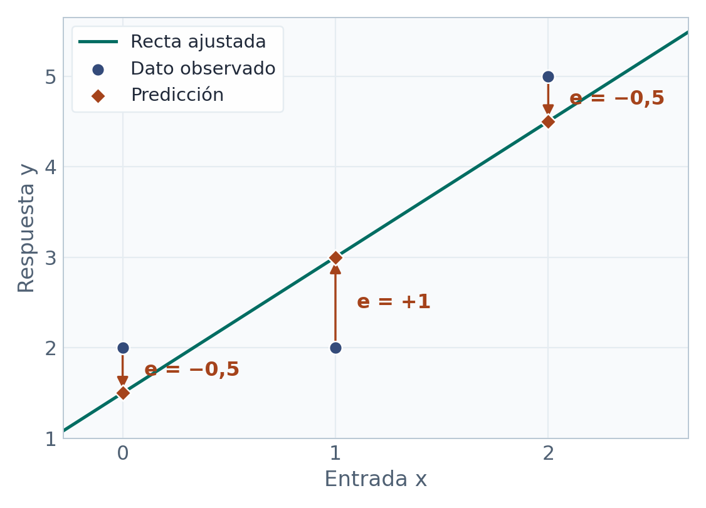
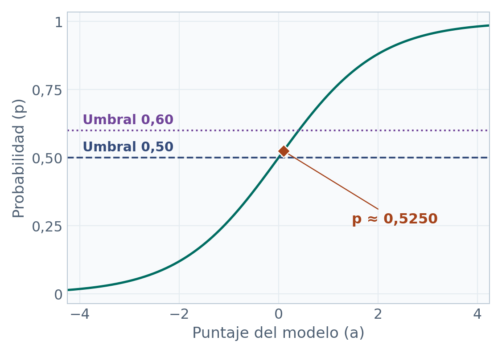

# Regresión y clasificación lineal

[← Anterior](01-preparacion-y-pca.md) · [Inicio](README.md) · [Ayuda memoria](06-ayuda-memoria.md#modelos-lineales) · [Practicar](07-ejercicios-propuestos.md#modelos-lineales) · [Pauta](09-pauta.md#modelos-lineales) · [Siguiente →](03-svm.md)

## Teoría

Un modelo lineal combina cada característica con un peso. Con una sola entrada, $\hat y=wx+b$. $w$ mide el cambio de la predicción por unidad de $x$. $b$ es el intercepto, es decir, la predicción en $x=0$. Con varias entradas se suman sus productos con los pesos.

En regresión, el **residuo** será $e_i=\hat y_i-y_i$. Un residuo positivo indica que predijiste de más. Elevar los residuos al cuadrado evita que errores de signos opuestos se cancelen y da más importancia a errores grandes.

### Encontrar los parámetros

Si juntamos los datos en una matriz de diseño $X$ con una columna de unos, el vector de parámetros puede escribirse $\theta=(b,w)^\top$. Las predicciones se calculan con $X\theta$. **Mínimos cuadrados** elige los parámetros que minimizan la suma de residuos cuadrados. Para obtener las ecuaciones normales, se deriva el costo y se iguala el gradiente a cero.

```math
J=\frac{1}{2n}\sum_i e_i^2,\qquad
\nabla J=\frac{1}{n}X^\top(X\theta-y),\qquad
X^\top X\theta=X^\top y.
```

En la Clase 9 también verás $J=\mathrm{MSE}$, que usa $1/n$. Eso duplica el gradiente y deja el mismo mínimo para el costo cuadrático sin penalizar. Lee siempre el factor del enunciado. Si las columnas son dependientes, la solución en pesos puede dejar de ser única. En Python, `np.linalg.lstsq` permite ajustar sin invertir $X^\top X$ a mano.

**Descenso de gradiente** parte con parámetros iniciales. Primero calcula todas las derivadas en ese mismo punto. Después resta a cada parámetro su derivada por la tasa $\alpha$. La derivada de $e_i^2$ es $2e_i$ por la derivada de $e_i$. Como $e_i=wx_i+b-y_i$, el segundo factor es $x_i$ para $w$ y 1 para $b$.

Una tasa muy pequeña puede avanzar lentamente. Una muy grande puede aumentar el costo u oscilar. Escalar puede ayudar al optimizador. **Batch** usa todos los ejemplos por paso, **estocástico** usa uno y **mini-batch** usa un grupo.

### Generalizar a datos nuevos

| Señal | Qué revisar |
| --- | --- |
| Error alto en entrenamiento y validación | Posible subajuste. El modelo puede ser demasiado simple o estar demasiado penalizado. |
| Error bajo en entrenamiento y alto en validación | Posible sobreajuste. La validación te ayuda a elegir la complejidad. |
| Residuos con curvatura | Puede faltar una relación que la recta no representa. |
| Residuos con dispersión que cambia | El tamaño típico del error puede depender de la entrada o del nivel predicho. |

Ridge agrega L2, una suma de cuadrados de pesos. Lasso agrega L1, una suma de valores absolutos que puede dejar coeficientes exactamente en cero. En los ejercicios con penalización, el intercepto se mantiene fuera de ella. En un pipeline polinómico se crean potencias o interacciones, se escala y se ajusta Ridge. Los grados y las penalizaciones se comparan con validación.

### De puntaje a clase

En logística binaria, primero calculas el puntaje $a=wx+b$. Aplicas $\sigma(a)=1/(1+\exp(-a))$ para obtener $p$, la probabilidad estimada de $y=1$. Con umbral $0{,}5$, el puntaje cero está en la frontera. Bajar el umbral hace que más ejemplos, o los mismos, queden predichos como positivos. El umbral se elige con validación y según el costo de los errores.

La **verosimilitud** multiplica la probabilidad asignada a cada etiqueta real, bajo el supuesto de independencia de ejemplos dado el modelo. La **BCE**, o entropía cruzada binaria, toma el logaritmo natural negativo de ese producto y lo promedia. Para $y=1$ el aporte es $-\ln p$. Para $y=0$ es $-\ln(1-p)$.

<details>
<summary>De dónde sale p − y en el gradiente logístico</summary>

La sigmoide tiene derivada $p(1-p)$ respecto del puntaje. Al derivar la BCE por fila respecto de $p$, queda $(p-y)/(p(1-p))$. La regla de la cadena multiplica ambas derivadas, por lo que se cancela $p(1-p)$ y queda $p-y$. La derivada por $w$ suma un factor $x_i$ y la derivada por $b$ suma un factor 1.

</details>

### Enfoque probabilístico: GaussianNB y BayesianRidge

- **`GaussianNB`** es un clasificador **generativo**: modela cada atributo con una distribución gaussiana dentro de cada clase y supone independencia condicional entre atributos dada la clase.
- **`BayesianRidge`** ajusta regresión lineal con regularización L2 bajo un enfoque bayesiano y puede devolver la **media** y la **desviación estándar predictivas**: una desviación mayor indica más incertidumbre y ensancha el intervalo predictivo aproximado.

## Ejercicios resueltos

### 1. Ajustar una recta y medir su error

**Enunciado.** Entrena una recta con $(x,y)=(0,2),(1,2),(2,5)$. **a)** Arma las ecuaciones normales y despeja $b,w$. **b)** Calcula los residuos, MAE, MSE, RMSE y $R^2$ en esos datos. **c)** Predice para $x=3$.

**a) Resolver el sistema.** Las filas de $X$ son $(1,0)$, $(1,1)$ y $(1,2)$. Sus columnas suman 3 y 3. Los cuadrados de la segunda suman 5. La suma de $y$ es 9 y la suma de $xy$ es 12.

```math
\begin{pmatrix}3&3\\3&5\end{pmatrix}
\begin{pmatrix}b\\w\end{pmatrix}
=\begin{pmatrix}9\\12\end{pmatrix}.
```

Al restar la primera ecuación de la segunda, queda $2w=3$. Con $w=1{,}5$, la primera ecuación da $b=1{,}5$.

**b) Leer los errores.** Las predicciones son $(1{,}5,3,4{,}5)$ y los residuos $(-0{,}5,1,-0{,}5)$. La suma de valores absolutos es 2 y la suma de cuadrados es $1{,}5$. La media de $y$ es 3 y predecir siempre 3 da suma de cuadrados $1+1+4=6$.



En $x=1$, la flecha sube desde el valor real 2 hasta la predicción 3. Por eso, con la convención $e=\hat y-y$, ese residuo vale $+1$. En las otras dos filas la predicción queda más abajo y el residuo es negativo.

```math
\begin{aligned}
\mathrm{MAE}&=\frac23,           & \mathrm{MSE}&=0{,}5,\\
\mathrm{RMSE}&=\sqrt{0{,}5},     & R^2&=1-\frac{1{,}5}{6}=0{,}75.
\end{aligned}
```

MAE y RMSE se leen en la unidad de $y$. En $R^2=1-\mathrm{SSE}/\mathrm{SST}$, $\mathrm{SSE}=\sum_i e_i^2$ es la suma de errores cuadrados del modelo y $\mathrm{SST}=\sum_i(y_i-\bar y)^2$ es la variación total respecto de la media. $R^2$ puede ser negativo en datos de evaluación si el modelo queda por debajo de esa referencia.

**c) Predecir.** $\hat y(3)=1{,}5(3)+1{,}5=6$. El punto queda fuera del rango observado: es una extrapolación.

**Resultado.** La recta es $\hat y=1{,}5x+1{,}5$. **Cómo comprobarlo.** en estos datos de ajuste, los residuos suman cero y la recta pasa por $(\bar x,\bar y)=(1,3)$.

### 2. Actualizar pendiente e intercepto y comparar con Ridge

**Enunciado.** Usa los mismos tres puntos, costo $J=(1/2n)\sum_i e_i^2$, punto inicial $(b,w)=(1,1)$ y tasa $\alpha=0{,}2$. **a)** Calcula un paso de gradiente y el costo después del paso. **b)** Repite desde el punto inicial con penalización $\lambda w^2/2$ y $\lambda=0{,}5$.

**a) Calcular antes de actualizar.** Al inicio predices $(1,2,3)$ y tienes residuos $(-1,0,-2)$. Para $b$ promedia los residuos. Para $w$ promedia cada residuo multiplicado por su $x$.

```math
g_b=(-1+0-2)/3=-1,\qquad
g_w=(0+0-4)/3=-4/3.
```

Ahora resta $0{,}2$ veces cada derivada. Sale $b'=1{,}2$ y $w'=19/15\approx1{,}2667$. Los nuevos residuos exactos son $-4/5$, $7/15$ y $-19/15$. Al elevarlos al cuadrado, sumarlos y dividir por 6, el costo cambia de $5/6$ a $277/675\approx0{,}4104$.

**b) Agregar L2.** Al derivar $\lambda w^2/2$ respecto de $w$ queda $\lambda w=0{,}5$. Así, $g_w=-4/3+1/2=-5/6$ y $w'=1+0{,}2(5/6)=7/6$. Como $b$ no se penaliza en este costo, $b'=1{,}2$.

**Resultado.** El incremento en $w$ es $0{,}2667$ sin penalización y $0{,}1667$ con ella. **Cómo comprobarlo.** la diferencia entre los pesos actualizados es $\alpha\lambda w^{(0)}=0{,}1$.

<details>
<summary>Mini práctica: usar el MSE en el inciso a</summary>

El gradiente se duplica al quitar el factor $1/2$. Con $\alpha=0{,}1$ obtienes exactamente el mismo paso que antes.

</details>

### 3. Calcular BCE y hacer un paso de logística

**Enunciado.** Usa $(x,y)=(0,0),(1,1)$, con $(b,w)=(0,0)$, tasa $\alpha=0{,}4$ y costo BCE media más $\lambda w^2/2$, con $\lambda=0{,}2$. **a)** Calcula los puntajes, probabilidades, clases iniciales con regla $p\ge0{,}5$, verosimilitud y costo. **b)** Da un paso y vuelve a evaluar el costo. **c)** Decide la clase de la segunda fila con umbral $0{,}6$ después del paso.

**a) Evaluar el inicio.** Los dos puntajes valen cero, así que ambas probabilidades valen $0{,}5$ y se predicen dos positivos. La primera fila asigna $1-p_1=0{,}5$ a su etiqueta y la segunda asigna $p_2=0{,}5$. La verosimilitud es $0{,}25$. La BCE media es $-\ln(0{,}25)/2\approx0{,}6931$. L2 aporta cero al inicio.

**b) Actualizar juntos.** Los términos $p_i-y_i$ son $0{,}5$ y $-0{,}5$. Para $b$ se cancelan. Para $w$, la primera fila aporta 0 y la segunda $-0{,}5$. Al promediar y sumar $\lambda w=0$, queda $g_w=-0{,}25$. El nuevo $b$ vale 0 y el nuevo $w$ vale $0-0{,}4(-0{,}25)=0{,}1$.

La primera probabilidad sigue en $0{,}5$. La segunda sale de $\sigma(0{,}1)\approx0{,}5250$. Para la BCE, promedia $-\ln(1-0{,}5)$ y $-\ln(\sigma(0{,}1))$. Obtienes aproximadamente $0{,}6688$. Al sumar $(0{,}2/2)(0{,}1)^2=0{,}001$, el costo es aproximadamente $0{,}6698$.

**c) Aplicar el umbral.** Como $0{,}5250<0{,}6$, esa fila queda en la clase 0 al subir el umbral.



El rombo queda a la misma altura al cambiar el umbral. Supera la línea de $0{,}50$ y queda bajo la de $0{,}60$. Por eso la misma probabilidad da clase 1 con el primer umbral y clase 0 con el segundo.

**Resultado.** El paso baja el costo de $0{,}6931$ a $0{,}6698$. **Cómo comprobarlo.** tras el paso, la probabilidad asignada a la etiqueta real de la segunda fila sube sobre $0{,}5$. El umbral cambia la decisión sin alterar esa probabilidad.

## Resumen y errores frecuentes

- Identifica si el enunciado usa SSE, MSE o MSE/2 antes de derivar. Calcula todas las derivadas con los parámetros viejos.
- Para logística, usa probabilidades en BCE y gradiente. Usa clases umbralizadas para contar aciertos. Con `LogisticRegression`, un `C` más pequeño aumenta la regularización. La conversión a $\lambda$ depende de cómo esté definido el costo.
- GaussianNB modela cada atributo con una distribución gaussiana por clase y supone independencia condicional. BayesianRidge puede devolver una media y una desviación estándar predictivas. Una desviación mayor ensancha el intervalo predictivo aproximado.
- En lectura de código, revisa la división de datos, las formas de `X` e `y` y dónde ocurre `fit`, incluso si el código lo generó una IA.

**Material del curso** · *Clase 9. Regresión y clasificación lineal*, pp. 4–84. *Clase 10. Clasificadores fundamentales*, pp. 6–16. *Ayudantía 05*, ejercicios 2–4.

---

[← Anterior: 1. Preparación de datos y PCA](01-preparacion-y-pca.md) · [Inicio](README.md) · [Practicar este tema](07-ejercicios-propuestos.md#modelos-lineales) · [Siguiente: 3. Clasificadores fundamentales y SVM →](03-svm.md)
