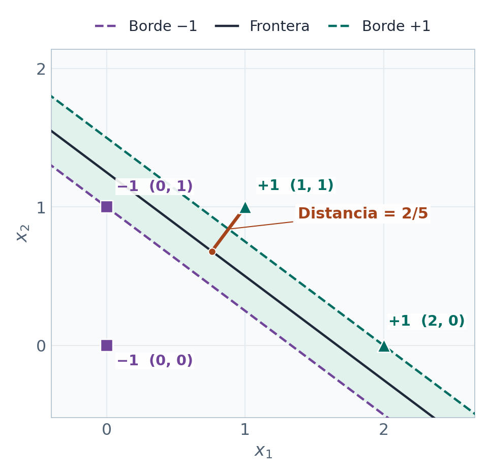

# Clasificadores fundamentales y SVM

[Inicio](README.md) · [Ayuda memoria](06-ayuda-memoria.md#svm) · [Practicar](07-ejercicios-propuestos.md#svm) · [Pauta](09-pauta.md#svm)

## Teoría

Clasificar es elegir una categoría. Un modelo **paramétrico**, como la regresión logística, tiene un número fijo de parámetros cuando fijas cuántos atributos recibe. En un modelo **no paramétrico**, su representación puede crecer con los datos. Por ejemplo, k-NN conserva ejemplos, un árbol puede tener más nodos y una SVM con RBF puede necesitar más soportes. Una SVM representada directamente por un vector lineal $w$ y un sesgo $b$ tiene tamaño fijo para una cantidad fija de atributos.

Un modelo **discriminativo** aprende una regla de decisión o una probabilidad de clase a partir de las entradas. SVM y logística son ejemplos. Un modelo **generativo** puede modelar cómo se distribuyen los atributos dentro de cada clase, como GaussianNB.

### Frontera, puntaje y margen

Para la SVM binaria de la clase, usa etiquetas $-1,+1$. El puntaje $f(x)=w^\top x+b$ multiplica cada coordenada por su peso y suma el sesgo. La frontera es $f(x)=0$. En dos dimensiones es una recta perpendicular a $w$. Cambiar solo $b$ mueve la recta en paralelo. Para $f(x)>0$ predices $+1$ y para $f(x)<0$ predices $-1$. Si el punto cae justo en la frontera, aplica la regla de desempate que se indique.

Con los bordes canónicos $f(x)=\pm1$, el ancho total entre ellos es $2/\lVert w\rVert$ y la distancia de un punto a la frontera es $\lvert f(x)\rvert/\lVert w\rVert$. La norma $\lVert w\rVert$ es el largo de $w$. Multiplicar $w$ y $b$ por un mismo número positivo conserva la frontera y el signo de las predicciones. Para interpretar el margen entrenado, usa la escala que fija sus bordes.

### Qué intenta optimizar SVM

- **Margen duro.** Minimiza $\lVert w\rVert^2/2$ con la condición $y_i f(x_i)\ge1$ para cada fila. Esto exige separación y suficiente margen. Los puntos de borde en la solución de margen duro son los soportes geométricos.
- **Margen suave.** Permite faltas de margen. Calcula $m_i=y_i f(x_i)$ y $\ell_i=\max(0,1-m_i)$. Un margen entre 0 y 1 indica acierto dentro de la franja. Un margen negativo indica error. Si $m_i=0$, la decisión depende del desempate.
- **Parámetro `C`.** En el objetivo $\lVert w\rVert^2/2+C\sum_i\ell_i$, un `C` mayor da más peso a las violaciones. Se elige con validación.

<details>
<summary>De dónde sale el cambio en los pesos en margen suave</summary>

Si $y_i f(x_i)<1$, la pérdida de esa fila es $1-y_i(w^\top x_i+b)$. Su aporte al gradiente respecto de $w$ es $-y_i x_i$ y respecto de $b$ es $-y_i$. Si $y_i f(x_i)>1$, ambos aportes valen cero. En $y_i f(x_i)=1$ la función tiene una esquina y se puede usar un subgradiente. El término cuadrático agrega $w$ al gradiente respecto de $w$.

</details>

### Qué aporta un kernel

Un kernel calcula un producto punto en una representación transformada sin tener que escribir todas sus coordenadas. Puedes obtener fronteras curvas en el espacio original. Una matriz de kernel compara pares de ejemplos, con entrada $K_{ij}=K(x_i,x_j)$.

| Kernel | Fórmula típica |
| --- | --- |
| Lineal | $K(x,z)=x^\top z$ |
| Polinómico homogéneo | $K(x,z)=(x^\top z)^d$ |
| RBF | $K(x,z)=\exp(-\gamma\lVert x-z\rVert^2)$ |

En RBF, puntos cercanos aportan más similitud. A una distancia fija distinta de cero, subir $\gamma$ reduce la similitud. Un puntaje SVM combina kernels con coeficientes de los soportes y un intercepto. Su signo permite predecir la clase. Para estimar probabilidades hace falta un método de calibración, como el que aparece en el Laboratorio 02.

## Ejercicios resueltos

### 1. Encontrar la frontera y leer sus bordes

**Enunciado.** Considera $w=(3,4)$ y $b=-5$. Los positivos son $(2,0)$ y $(1,1)$. Los negativos son $(0,1)$ y $(0,0)$. **a)** Encuentra la frontera y los bordes $f=\pm1$. **b)** Calcula el ancho de la franja, los puntos que tocan los bordes y la distancia de $(1,1)$ a la frontera.

**a) Escribir el puntaje.** $f(x)=3x_1+4x_2-5$. La frontera cumple $3x_1+4x_2=5$. Los bordes cumplen $3x_1+4x_2=6$ para $+1$ y $3x_1+4x_2=4$ para $-1$.

**b) Sustituir las coordenadas y calcular la norma.**

| Punto | Clase real | Puntaje |
| --- | --- | --- |
| $(2,0)$ | $+1$ | $6+0-5=1$ |
| $(1,1)$ | $+1$ | $3+4-5=2$ |
| $(0,1)$ | $-1$ | $0+4-5=-1$ |
| $(0,0)$ | $-1$ | $0+0-5=-5$ |

Como $\lVert w\rVert=\sqrt{3^2+4^2}=5$, la franja mide $2/5$. El punto $(1,1)$ queda a distancia $2/5$ de la frontera. Su puntaje 2 indica que está más allá del borde positivo.



El segmento naranja mide desde un punto hasta la frontera. Para medir el ancho de la franja, mide perpendicularmente entre las dos líneas punteadas. En este ejercicio ambas cantidades valen $2/5$.

**Resultado.** Tocan los bordes $(2,0)$ y $(0,1)$. **Cómo comprobarlo.** cada uno queda a $1/5$ de la recta central, en lados opuestos. Estamos leyendo la franja de los parámetros dados. Para determinar los soportes de un ajuste SVM habría que verificar que dichos parámetros son la solución del problema de entrenamiento.

### 2. Calcular hinge y elegir entre dos candidatos

**Enunciado.** Para el candidato A, toma etiquetas $(+1,+1,-1,-1)$, puntajes $(1{,}6,0{,}4,0{,}3,-0{,}9)$ y $\lVert w_A\rVert^2=2$. Para el candidato B, ya se sabe que la suma de pérdidas hinge es $0{,}5$ y $\lVert w_B\rVert^2=8$. **a)** Encuentra los márgenes y la pérdida total de A. **b)** Compara los objetivos para $C=0{,}5$ y $C=4$.

**a) Multiplicar por la etiqueta antes de revisar el margen.**

| Fila | $m_i=y_i f(x_i)$ | $\max(0,1-m_i)$ |
| --- | --- | --- |
| 1 | $1{,}6$ | $0$ |
| 2 | $0{,}4$ | $0{,}6$ |
| 3 | $-0{,}3$ | $1{,}3$ |
| 4 | $0{,}9$ | $0{,}1$ |

La pérdida total es $2$. La segunda y cuarta filas aciertan dentro del margen. La tercera se clasifica mal y su penalización supera 1.

**b) Evaluar el objetivo.** A cuesta $1+2C$ y B cuesta $4+0{,}5C$. Con $C=0{,}5$, A cuesta 2 y B cuesta $4{,}25$. Con $C=4$, A cuesta 9 y B cuesta 6.

**Resultado.** A gana entre los candidatos con $C=0{,}5$ y B con $C=4$. **Cómo comprobarlo.** si igualas ambas expresiones, empatan en $C=2$.

### 3. Comparar puntos y predecir con RBF

**Enunciado.** **a)** Para $x=(1,2)$ y $z=(2,1)$ calcula el kernel lineal, el polinómico homogéneo de grado 2 y RBF con $\gamma=1$. **b)** Otro modelo RBF usa dos soportes en una dimensión, $s_+=1$ y $s_-=-1$, con etiquetas $+1,-1$, coeficientes $\alpha_+=\alpha_-=1$, $\gamma=1$ y $b=-0{,}2$. Calcula su puntaje y clase para $x=0{,}5$ con la regla del signo.

**a) Comparar en el espacio que pide el kernel.** El producto punto es $1(2)+2(1)=4$. El kernel de grado 2 eleva ese resultado al cuadrado, así que vale 16. Para RBF calculamos distancia cuadrada: $(1-2)^2+(2-1)^2=2$. El kernel da $\exp(-2)\approx0{,}1353$.

**b) Sumar similitudes ponderadas.** La distancia cuadrada al soporte positivo es $0{,}25$ y al negativo es $2{,}25$. Cada similitud se multiplica por el coeficiente y la etiqueta del soporte. Al final se suma $b$.

```math
f(0{,}5)=\exp(-0{,}25)-\exp(-2{,}25)-0{,}2
        \approx 0{,}4734.
```

**Resultado.** Se predice $+1$. **Cómo comprobarlo.** el soporte positivo está más cerca y su contribución supera la contribución negativa más el sesgo. El valor $0{,}4734$ se interpreta como puntaje de decisión.

<details>
<summary>Mini práctica: pasar de gamma 1 a gamma 2</summary>

En el inciso a, RBF pasa de $\exp(-2)$ a $\exp(-4)\approx0{,}0183$. A la misma distancia, el kernel cae al aumentar gamma. En una búsqueda real se vuelve a ajustar el modelo en cada fold.

</details>

## Resumen y errores frecuentes

- Dibuja o escribe primero la frontera $f=0$ y luego los bordes $\pm1$. Distingue el ancho total de la distancia desde un solo borde.
- Usa $y f(x)$ para hinge. El signo de $f(x)$ por sí solo da una predicción, pero necesitas la etiqueta real para saber si acertaste.
- Para RBF usa la distancia **al cuadrado**. Escala dentro del pipeline al comparar `C` y `gamma` con validación.

**Material del curso** · *Clase 10. Clasificadores fundamentales*, pp. 2–42. *Clase 9*, pp. 49–55. *Laboratorio 02*, pp. 33–36 y 56.
