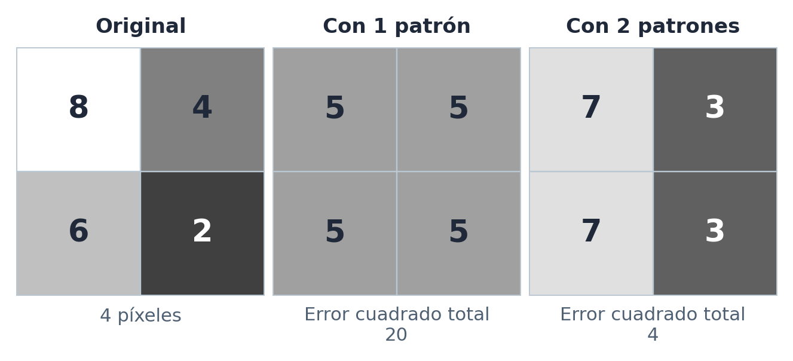

# Embeddings y evaluación

[← Anterior](03-svm.md) · [Inicio](README.md) · [Ayuda memoria](06-ayuda-memoria.md#embeddings-y-métricas) · [Practicar](07-ejercicios-propuestos.md#embeddings-y-métricas) · [Pauta](09-pauta.md#embeddings-y-métricas) · [Siguiente →](05-ensambles-y-validacion.md)

## Teoría

Una imagen en escala de grises es una matriz de intensidades. Al aplanarla, mantén siempre el mismo orden de píxeles. Una foto de $64\times64$ pasa a ser una fila de 4.096 números. Un **embedding** reemplaza esos números por pocas coordenadas. Cada coordenada puede decir cuánto se parece un rostro centrado a cierto patrón aprendido.

| Base | Para interpretar el laboratorio |
| --- | --- |
| Olivetti | 400 fotos de 40 identidades, 10 fotos por persona y condiciones más controladas. Con el split del laboratorio quedan 300 fotos para entrenamiento y 100 para prueba. |
| LFW | Mayor variedad de poses, luz y fondos. El laboratorio parte de identidades con al menos 20 fotos y conserva hasta 50. Se entrena y evalúa por separado. |

La tarea del laboratorio es reconocer **identidades conocidas** en fotos nuevas. Estratificar ayuda a conservar proporciones por identidad. Si la tarea fuera evaluar personas totalmente nuevas, habría que diseñar otra división que separe personas completas y replantear la predicción.

### PCA, LDA y Fisherfaces

- **PCA** aprende sin etiquetas. Calcula el rostro promedio de entrenamiento y direcciones de alta varianza. Una dirección de píxeles vista como imagen se llama *eigenface*. El número de direcciones con varianza positiva está limitado por el rango de los datos centrados.
- **LDA**, análisis discriminante lineal, usa las etiquetas. Busca proyecciones con mucha separación **entre** medias de clase y poca dispersión **dentro** de cada clase. Con $C$ clases y $p$ entradas, hay como máximo $\min(C-1,p)$ dimensiones y el rango efectivo puede ser menor.
- **Fisherfaces** hace PCA primero y LDA después. Si PCA entrega $d_{\mathrm{PCA}}$ coordenadas, LDA tiene como máximo $\min(C-1,d_{\mathrm{PCA}})$ dimensiones. Reducir antes sirve cuando hay muchos píxeles y pocas fotos. LDA se ajusta con las proyecciones y las etiquetas de entrenamiento.

Para una foto $x$, la coordenada $z_j$ se obtiene con el producto punto entre el patrón $w_j$ y la foto centrada $x-\mu$. Reconstruir significa sumar a la media $\mu$ las direcciones conservadas, cada una multiplicada por su coordenada. Las direcciones de PCA se pueden aplicar a observaciones nuevas sin recalcular la media ni los patrones.

### Del embedding a una predicción

| Clasificador | Cómo decide |
| --- | --- |
| k-NN | Busca los $k$ ejemplos más cercanos. Con pesos uniformes, la clase con más vecinos gana. La fracción de votos da la probabilidad estimada. |
| Árbol | Hace preguntas sobre las coordenadas hasta llegar a una hoja. Allí puede usar las proporciones de clase para estimar probabilidades. |
| SVM | Usa una frontera de decisión. En el laboratorio, la probabilidad mostrada se obtiene por calibración de Platt. |

Distingue una proyección para predecir de un mapa t-SNE o UMAP para explorar. En el laboratorio, los mapas muestran TRAIN. Dos puntos pueden quedar casi superpuestos en 2D aunque sean distintos en el embedding original. Para comparar modelos revisa la matriz de confusión y las métricas en la partición evaluada.

### Leer una matriz de confusión

Usaremos **filas reales** y **columnas predichas**. La diagonal tiene los aciertos. Para una clase, TP son sus aciertos. FP son entradas de su columna que pertenecían a otra clase. FN son entradas de su fila que se enviaron a otra clase.

```math
\begin{aligned}
\mathrm{precision}&=\frac{TP}{TP+FP},\\
\mathrm{recall}&=\frac{TP}{TP+FN},\\
F_1&=\frac{2TP}{2TP+FP+FN}.
\end{aligned}
```

La **accuracy** o exactitud es la fracción total de aciertos. **Macro-F1** promedia el F1 calculado para cada clase, dándoles el mismo peso. Si algún denominador es cero, sigue la convención del enunciado. En los ejemplos de código se puede fijar `zero_division=0` para F1.

## Ejercicios resueltos

### 1. Convertir una foto en dos coordenadas y reconstruirla

**Enunciado.** Una foto de $2\times2$ tiene filas $(8,4)$ y $(6,2)$. Aplánala leyendo por filas. La media aprendida es $\mu=(4,4,4,4)$ y los patrones unitarios son $w_1=(1,1,1,1)/2$ y $w_2=(1,-1,1,-1)/2$. **a)** Calcula el embedding con ambos. **b)** Reconstruye usando solo $w_1$ y luego usando ambos. Compara los errores cuadrados totales.

**a) Aplanar, centrar y proyectar.** La fila original es $(8,4,6,2)$. Restar $\mu$ deja $(4,0,2,-2)$. El producto con $w_1$ suma $4+0+2-2$ y divide por 2, así que $z_1=2$. El producto con $w_2$ suma $4-0+2-(-2)$ y divide por 2, así que $z_2=4$.

**b) Volver a los píxeles.** Con un patrón, $\mu+2w_1=(5,5,5,5)$. Sus diferencias respecto de la foto tienen magnitudes $(3,1,1,3)$ y los cuadrados suman 20. Con ambos patrones, hay que sumar además $4w_2=(2,-2,2,-2)$. Queda $(7,3,7,3)$, con diferencias de magnitud 1 en cada píxel y error cuadrado total 4.



Los tres paneles usan la misma escala de grises. Con un patrón la foto reconstruida queda de un solo tono. El segundo patrón recupera parte del contraste entre la columna izquierda y la derecha.

**Resultado.** El embedding es $(2,4)$. **Cómo comprobarlo.** al reconstruir con ambas direcciones se recupera más detalle. La reconstrucción sigue teniendo cuatro píxeles.

### 2. Medir separación con LDA y elegir dimensión

**Enunciado.** En una coordenada, la clase A tiene valores $1,3$ y B tiene $5,7$. **a)** Calcula la dispersión dentro de clases $S_W$, sumando distancias cuadradas a la media de cada clase. Calcula $S_B$ entre clases, sumando por cada clase el tamaño de la clase por su distancia cuadrada a la media global. Da el cociente $S_B/S_W$. **b)** En otro conjunto con cuatro clases, PCA entrega dos coordenadas. ¿Cuántas puede pedir Fisherfaces como máximo?

**a) Calcular las medias.** La media de A es 2, la de B es 6 y la global es 4. Las desviaciones dentro de A son $-1,+1$ y dentro de B se repiten. Sus cuatro cuadrados dan $S_W=4$. La media de cada clase está a distancia 2 de la media global. Como cada clase tiene dos filas, $S_B=2(2^2)+2(2^2)=16$. El cociente es $16/4=4$.

**b) Aplicar ambas cotas.** Con cuatro clases, el límite por etiquetas es $4-1=3$. PCA entrega solo dos entradas a LDA, de modo que el máximo es $\min(3,2)=2$.

**Resultado.** El cociente de dispersión en el primer conjunto es 4 y la dimensión máxima del segundo es 2. **Cómo comprobarlo.** si alejas toda la clase B sin cambiar su dispersión, $S_W$ se mantiene y $S_B$ crece.

<details>
<summary>Mini práctica: mantener PCA en dos coordenadas y usar dos clases</summary>

El nuevo límite es $\min(2-1,2)=1$. Fisherfaces puede usar una dirección discriminante como máximo.

</details>

### 3. Calcular macro-F1 y leer los errores

**Enunciado.** En la tabla, las filas son reales y las columnas predichas. **a)** Describe un error de la clase A y calcula su precision, recall y F1. **b)** Calcula la accuracy y el macro-F1.

| Real / predicha | A | B | C |
| --- | --- | --- | --- |
| A | 6 | 2 | 0 |
| B | 1 | 3 | 0 |
| C | 0 | 1 | 1 |

**a) Seguir la fila y la columna de A.** Dos elementos reales A quedaron como B. Para A, $TP=6$, $FP=1$ y $FN=2$. Luego precision $=6/7$, recall $=6/8$ y F1 $=12/(12+1+2)=0{,}8$.

**b) Repetir y promediar.** Para B, $TP=3$, $FP=3$ y $FN=1$, así que su F1 es $6/(6+3+1)=0{,}6$. Para C, $TP=1$, $FP=0$ y $FN=1$, de modo que su F1 es $2/3$. La tabla contiene 14 elementos y su diagonal suma 10.

```python
from sklearn.metrics import accuracy_score, f1_score

real = ["A"] * 8 + ["B"] * 4 + ["C"] * 2
pred = ["A"] * 6 + ["B"] * 2 + ["A"] + ["B"] * 3 + ["B", "C"]

print(round(accuracy_score(real, pred), 4))
print(round(f1_score(real, pred, average="macro"), 4))
```

**Resultado.** Accuracy $=10/14\approx0{,}7143$. Macro-F1 $=(0{,}8+0{,}6+2/3)/3\approx0{,}6889$. **Cómo comprobarlo.** el código reproduce las dos cifras. Cada clase aporta un tercio del macro-F1 aunque tenga un número diferente de fotos.

## Resumen y errores frecuentes

- En una foto nueva usa la media, los patrones y el orden de píxeles de entrenamiento. Revisa las formas al aplanar y proyectar.
- PCA conserva varianza y LDA busca separación con etiquetas. Comprueba la cota de dimensión de Fisherfaces.
- Una métrica evalúa predicciones. Un mapa se usa para explorar. En la matriz de confusión, lee primero el rótulo real y luego el predicho.

**Material del curso** · *Laboratorio 02. Embeddings faciales lineales*, pp. 3–47 y 55–68. *Laboratorio 03*, pp. 7–16.

---

[← Anterior: 3. Clasificadores fundamentales y SVM](03-svm.md) · [Inicio](README.md) · [Practicar este tema](07-ejercicios-propuestos.md#embeddings-y-métricas) · [Siguiente: 5. Ensambles y búsqueda →](05-ensambles-y-validacion.md)
