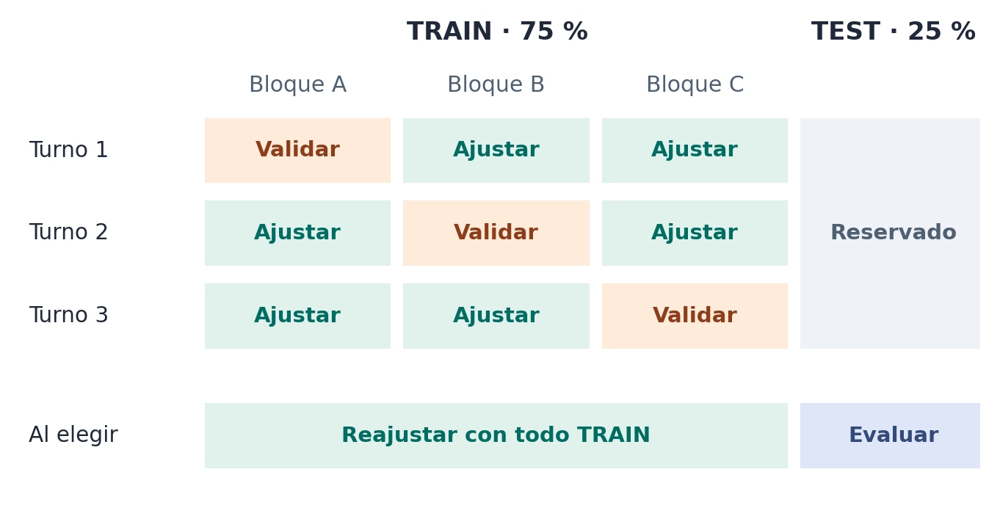

# Ensambles y búsqueda de hiperparámetros

[← Anterior](04-embeddings-y-metricas.md) · [Inicio](README.md) · [Ayuda memoria](06-ayuda-memoria.md#ensambles-y-validación) · [Practicar](07-ejercicios-propuestos.md#ensambles-y-validación) · [Pauta](09-pauta.md#ensambles-y-validación) · [Siguiente →](06-ayuda-memoria.md)

## Teoría

Un ensamble junta varios modelos. Combinar árboles puede reducir la sensibilidad de un solo árbol a los datos de entrenamiento o ir corrigiendo errores por etapas. En el Laboratorio 03 cada ensamble recibe el embedding y predice una identidad.

| Ensamble | Cómo aprende y decide |
| --- | --- |
| Random Forest | Los árboles se ajustan por separado. En el laboratorio, cada árbol recibe una muestra bootstrap y considera un subconjunto aleatorio de atributos en cada nodo. Se promedian las probabilidades de los árboles y gana la clase con mayor promedio. |
| AdaBoost | Aprende por rondas. Los ejemplos mal clasificados ganan importancia para la ronda siguiente. En la versión multiclase del laboratorio, cada modelo base aporta un voto ponderado por su desempeño. |
| Gradient Boosting | Aprende por etapas. Cada árbol nuevo aproxima una corrección derivada de la pérdida. Se suma una fracción de esa corrección a la puntuación actual. En el caso multiclase del lab, las puntuaciones por clase se convierten en probabilidades con softmax. |

Una muestra **bootstrap** se toma con reemplazo. Si partes de las observaciones $A,B,C,D$, una muestra posible es $A,A,D,B$. $A$ aparece dos veces y $C$ queda fuera. Eso aporta diversidad entre árboles. En boosting, la nueva etapa depende del modelo que ya tienes.

Un **parámetro** se estima durante `fit`, como los pesos de un modelo. Un **hiperparámetro** se configura para ese ajuste, como `max_depth`, `n_estimators` o `learning_rate`. Profundidad limita la complejidad de cada árbol. Número de estimadores controla cuántos árboles o etapas se consideran. La tasa de aprendizaje de boosting escala la contribución de las etapas.

### Separar, buscar, reajustar y evaluar

1. **Separa antes de aprender.** Reserva TEST. En el laboratorio, el split inicial es estratificado 75/25 por identidad.
2. **Usa validación cruzada dentro de TRAIN.** Divide TRAIN en tres folds. Cada turno aprende con dos y valida con el tercero. Para comparar candidatos o estrategias, reutiliza los mismos folds.
3. **Entrega el pipeline completo a la búsqueda.** El escalado, la selección, PCA o LDA aprenden solo con la parte de ajuste de cada fold. En el bloque que valida, reutiliza esas transformaciones y predice. Usar TRAIN completo para preajustar PCA antes de CV también filtra información.
4. **Selecciona y reajusta.** Con `refit="f1_macro"` y varias métricas, se elige por macro-F1 medio y se reajusta el mejor pipeline con todo TRAIN. `best_score_` es el promedio de validación del ganador y `best_params_` dice sus hiperparámetros. `cv_results_` permite examinar los candidatos y la variación de sus puntajes.
5. **Evalúa en TEST.** Usa `predict` con el pipeline reajustado y calcula sus métricas en las etiquetas apartadas. Reporta por separado calidad de validación y de prueba, además del costo de búsqueda. La exactitud y el macro-F1 responden preguntas distintas.



Sigue el bloque A en el diagrama. Sirve para validar en el primer turno y participa en el ajuste de los otros dos. En cada turno, PCA y el clasificador aprenden con los dos bloques marcados como **Ajustar**.

**Grid Search** recorre toda la cuadrícula dada. **Random Search** evalúa un número de muestras controlado por `n_iter`. Con listas finitas como las del laboratorio se pueden tomar combinaciones distintas con una semilla fija. Una búsqueda con menos candidatos puede encontrar el mismo ganador o quedarse con otro.

## Ejercicios resueltos

### 1. Comparar cómo deciden tres ensambles

**Enunciado.** El orden de clases es A, B, C. **a)** Tres árboles de un bosque dan probabilidades $(0{,}6,0{,}3,0{,}1)$, $(0{,}1,0{,}7,0{,}2)$ y $(0{,}2,0{,}6,0{,}2)$. ¿Qué clase gana? **b)** En otro modelo, tres estimadores de AdaBoost votan A, B, A, con pesos $0{,}4$, $0{,}8$ y $0{,}3$. ¿Qué clase gana? **c)** En una ronda binaria ilustrativa de Gradient Boosting, $y=1$, el puntaje antes de la ronda es 0 y el árbol nuevo predice una corrección de $0{,}4$. Usa tasa $0{,}2$ y sigmoide. Calcula el pseudoresiduo inicial $y-p$ y la probabilidad nueva.

**a) Promediar por columna.** A recibe $(0{,}6+0{,}1+0{,}2)/3=0{,}3$. B recibe $(0{,}3+0{,}7+0{,}6)/3\approx0{,}5333$. C recibe $(0{,}1+0{,}2+0{,}2)/3\approx0{,}1667$. B tiene el promedio mayor.

**b) Sumar votos según su peso.** A recibe $0{,}4+0{,}3=0{,}7$, B recibe $0{,}8$ y C recibe 0. Gana B. Un voto de mayor peso puede superar dos votos más livianos.

**c) Corregir el puntaje.** Inicialmente $\sigma(0)=0{,}5$, así que $y-p=0{,}5$. El árbol intenta aproximar esa dirección de corrección a partir de los datos. Suma $0{,}2(0{,}4)=0{,}08$ al puntaje y ahora aplica la sigmoide: $\sigma(0{,}08)\approx0{,}5200$.

**Resultado.** B gana en los dos problemas multiclase. En el binario, la probabilidad para la clase positiva sube de $0{,}5$ a aproximadamente $0{,}5200$. **Cómo comprobarlo.** las probabilidades del bosque suman 1. En Gradient Boosting la corrección se añade al puntaje.

<details>
<summary>Mini práctica: leer una ronda de AdaBoost</summary>

Cuatro ejemplos parten con pesos iguales y el modelo falla solo uno. Tras aumentar el peso relativo de los errores y normalizar, un reparto ilustrativo es $1/6$ para cada acierto y $1/2$ para el error. Los cuatro pesos suman 1 y la próxima ronda dará más atención al ejemplo que falló.

</details>

### 2. Contar los ajustes y elegir por validación

**Enunciado.** Cada combinación de representación y ensamble tiene 12 configuraciones posibles. Grid evalúa las 12 y Random evalúa 6. Ambos usan 3 folds y reajustan su ganador una vez. Hay tres representaciones y tres ensambles por base. **a)** Cuenta los ajustes por combinación y por base. **b)** Para dos candidatos del mismo método, los macro-F1 son A: $(0{,}69,0{,}78,0{,}69)$, B: $(0{,}73,0{,}72,0{,}74)$. Elige cuál reajustar.

**a) Multiplicar candidatos por folds.**

| Búsqueda | Por combinación | En las nueve combinaciones |
| --- | --- | --- |
| Grid | $12(3)+1=37$ | 324 ajustes de CV + 9 reajustes |
| Random | $6(3)+1=19$ | 162 ajustes de CV + 9 reajustes |

Son 18 búsquedas por base y $486+18=504$ ajustes del pipeline. Si se repite el mismo esquema en dos bases, son 36 búsquedas y 1.008 ajustes.

**b) Promediar los tres turnos.** A suma $2{,}16$ y su promedio es $0{,}72$. B suma $2{,}19$ y promedia $0{,}73$. B tiene el mayor promedio y se reajusta con todo TRAIN.

**Resultado.** Por base se hacen 504 ajustes y, para los candidatos del inciso b, se elige B. **Cómo comprobarlo.** los 18 reajustes se suman una vez por búsqueda, fuera del conteo de CV. El máximo de un solo fold de A es $0{,}78$, pero el criterio usa la media.

### 3. Leer una búsqueda de principio a fin

**Enunciado.** En Iris vamos a comparar Grid y Random sobre `PCA → RandomForestClassifier`. Se reservan el 25 % para TEST, 3 folds para CV y 3 candidatos para Random. Grid combina 2 valores de profundidad y 2 valores de cantidad de árboles. **a)** Completa mentalmente qué datos recibe cada `fit` y por qué la clave de profundidad empieza con `bosque__`. **b)** Identifica de dónde salen las dos métricas que se imprimen. **c)** Cuenta los ajustes si se ejecutan ambas búsquedas.

```python
from sklearn.datasets import load_iris
from sklearn.decomposition import PCA
from sklearn.ensemble import RandomForestClassifier
from sklearn.metrics import f1_score
from sklearn.model_selection import (
    GridSearchCV, RandomizedSearchCV, StratifiedKFold, train_test_split,
)
from sklearn.pipeline import Pipeline

X, y = load_iris(return_X_y=True)
X_train, X_test, y_train, y_test = train_test_split(
    X, y, test_size=0.25, stratify=y, random_state=42
)
pipeline = Pipeline([
    ("pca", PCA(n_components=2)),
    ("bosque", RandomForestClassifier(random_state=42)),
])
espacio = {"bosque__max_depth": [2, 4], "bosque__n_estimators": [10, 20]}
cv = StratifiedKFold(n_splits=3, shuffle=True, random_state=42)
opciones = dict(cv=cv, scoring={"f1_macro": "f1_macro"}, refit="f1_macro")

grid = GridSearchCV(pipeline, espacio, **opciones)
azar = RandomizedSearchCV(
    pipeline, espacio, n_iter=3, random_state=42, **opciones
)

for nombre, busqueda in [("Grid", grid), ("Random", azar)]:
    busqueda.fit(X_train, y_train)
    pred = busqueda.predict(X_test)
    print(nombre, busqueda.best_params_)
    print("CV:", round(busqueda.best_score_, 4))
    print("TEST:", round(f1_score(y_test, pred, average="macro"), 4))
```

**a) Seguir el ajuste.** Cada búsqueda recibe `X_train, y_train`. Dentro de cada fold, ajusta PCA con la parte de entrenamiento del turno y ajusta el bosque con sus coordenadas y etiquetas. `bosque__max_depth` apunta a `max_depth` dentro de la etapa llamada `bosque`. Son dos guiones bajos.

**b) Separar las dos mediciones.** `best_score_` promedia el macro-F1 de los folds para el candidato ganador. `predict(X_test)` aplica el mejor pipeline ya reajustado con TRAIN. `f1_score(y_test, pred, average="macro")` promedia el F1 de cada clase en las observaciones reservadas. Para seleccionar el modelo, usa el criterio definido en CV.

**c) Contar.** Grid prueba $2(2)=4$ candidatos y gasta $4(3)+1=13$ ajustes. Random gasta $3(3)+1=10$.

**Resultado.** Se hacen 23 ajustes, contando ambos reajustes. **Cómo comprobarlo.** cada búsqueda tendrá 4 o 3 filas de candidatos en `cv_results_["params"]`, respectivamente.

## Resumen y errores frecuentes

- Distingue promediar probabilidades, sumar votos ponderados y corregir una pérdida. En multiclase, sigue el orden de clases al leer los resultados.
- Cuenta primero el producto de candidatos por folds. Agrega un reajuste por búsqueda cuando está activado.
- Usa los mismos folds y la misma métrica para comparar estrategias. Ajusta las transformaciones dentro del pipeline. En el lab las dimensiones de los embeddings están fijadas para comparar los ensambles.
- Lee la calidad junto con el costo de búsqueda. Anota semillas y compara casos concretos de confusión para justificar una elección.

**Material del curso** · *Laboratorio 03. Ensambles y búsqueda de hiperparámetros*, pp. 9–43 y 46–49. *Clase 9*, pp. 56–62.

---

[← Anterior: 4. Embeddings y evaluación](04-embeddings-y-metricas.md) · [Inicio](README.md) · [Practicar este tema](07-ejercicios-propuestos.md#ensambles-y-validación) · [Siguiente: Ayuda memoria →](06-ayuda-memoria.md)
